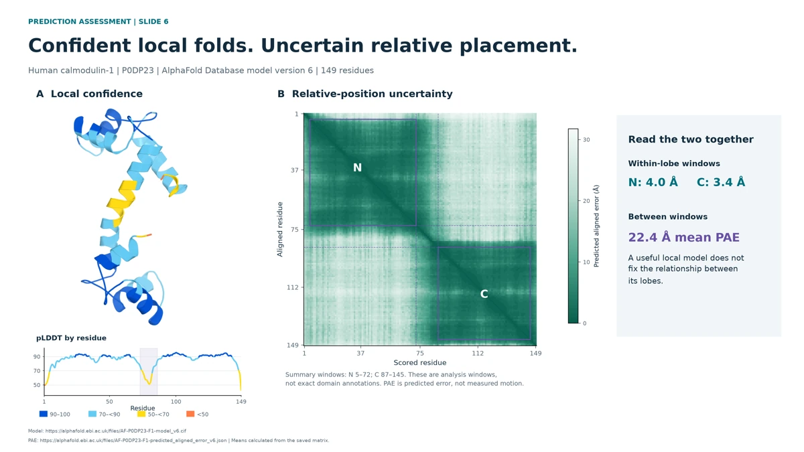
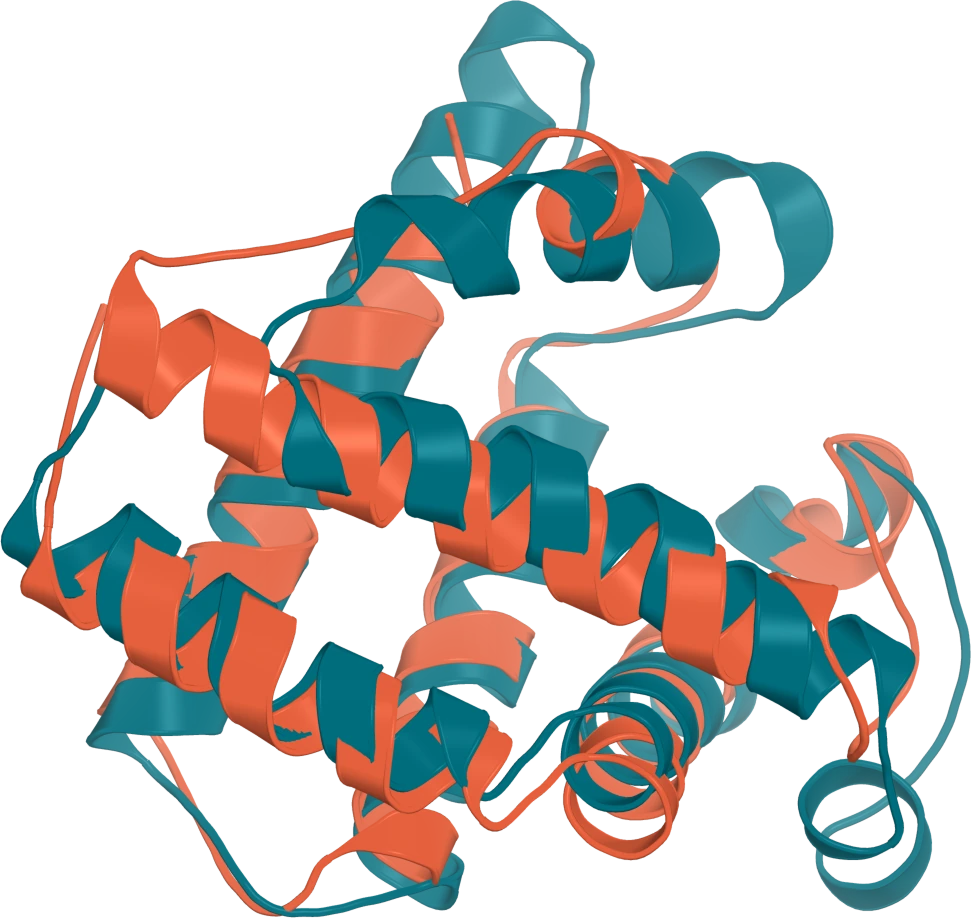

## Start with the claim

A useful analysis starts with a biological question, not a software menu. Keep three kinds of statement separate: experimental observations, computational predictions and biological hypotheses.

“The model has a cavity” is a different claim from “the cavity determines substrate specificity.” Use a chain of reasoning: question, evidence, retrieve or predict, assess, compare and test.

## Sequence information is structural evidence

Conservation asks which features tend to remain similar, whereas covariation asks which changes occur together; coupling analysis can turn evolutionary patterns into testable structural hypotheses ([EVcouplings](https://evcouplings.org/)). A hand-built alignment used for teaching is not a measured coupling analysis, and a correlated pair is not automatically a validated physical contact.

Protein language models learn sequence representations, but a representation is not itself a set of 3D coordinates; ESMC and structure-prediction systems have distinct roles ([ESM documentation](https://github.com/Biohub/esm)). Check the specific model's inputs instead of assuming that all language-model-based predictors are MSA-free.

## Retrieve a model or specify a prediction

An existing model in AlphaFold Database and a new prediction with specified components answer different operational questions ([AlphaFold Database](https://alphafold.ebi.ac.uk/), [AlphaFold Server](https://alphafoldserver.com/)). Record the accession, sequence construct, model version, chains, cofactors and ligand definitions before interpreting an output.

A protein-only prediction, an assembly and a protein–ligand complex are not interchangeable tasks. Actual interfaces may restrict which components can be supplied, so consult their current documentation ([AlphaFold Server guide](https://alphafoldserver.com/guides), [Boltz inputs](https://github.com/jwohlwend/boltz/blob/main/docs/prediction.md)).

## Confidence has a spatial scale

Local confidence and uncertainty in relative placement are different questions: pLDDT concerns local modelling confidence, whereas PAE concerns expected relative-position error under alignment ([confidence guide](https://alphafoldserver.com/guides)). Neither is a direct measurement of motion or a kinetic trajectory.

In the calmodulin example, confidence within a lobe does not settle the relative arrangement of the two lobes. The analysis windows and summaries are explicitly defined in the lecture; they are not exact domain annotations or experimental deviations.

The displayed model is the existing AFDB calmodulin prediction, with its own model version and confidence data ([model](https://alphafold.ebi.ac.uk/files/AF-P0DP23-F1-model_v6.cif), [PAE](https://alphafold.ebi.ac.uk/files/AF-P0DP23-F1-predicted_aligned_error_v6.json)). Comparison with calcium-bound 1CLL supplies experimental context, not proof that the prediction is a particular apo state ([1CLL](https://www.rcsb.org/structure/1CLL)).

## Search broadly, then inspect

Foldseek searches structural similarity rather than requiring a high sequence identity between query and hit ([Foldseek](https://github.com/steineggerlab/foldseek)). Record the query chain, database version, search mode, ordering and alignment definition.

The lecture uses a completed 1MBN-chain-A search against server-reported PDB100 version `20240101`, not a claim to search a continuously current complete PDB ([database metadata](https://search.foldseek.com/api/databases)). A returned structural match is a comparison to inspect, not automatically a functional assignment.

### The PDB100 caveat

**PDB100 is redundancy-reduced, not guaranteed one hit per unique amino-acid sequence.** In the saved demonstration, 1MBN A, 1U7S A and 104M A have identical complete 153-residue database sequences; those full-length duplicate hits are not explained by a short local alignment ([saved response](https://search.foldseek.com/api/result/9JUQmuFtzzCi-ufQrRv0mkHE562y671NBHSwsw/0)).

Published construction uses Foldseek clustering with `-c 0.95 --min-seq-id 1.0`, but the threshold is not a requirement on the identity of each query hit ([database methods](https://www.nature.com/articles/s41592-025-02593-7)). The precise internal reason for these duplicates in the saved monomer job has not been established; do not present cluster expansion, different ligands or conformational differences as its verified cause.

Count returned structural entries as entries, not automatically as distinct sequences, proteins or folds. If sequence uniqueness matters to your biological question, inspect and group the actual returned sequences explicitly.

## Compare what was actually aligned

Alignment scores depend on selections, matched positions, length normalisation and definitions of identity ([Foldseek output documentation](https://github.com/steineggerlab/foldseek)). A search alignment and a later TM-align comparison can legitimately have different sequence identities.

The lecture compares the returned 1FSL chain B with 1MBN chain A, rather than silently substituting a different chain ([1FSL](https://www.rcsb.org/structure/1FSL), [1MBN](https://www.rcsb.org/structure/1MBN)). A similar globin organisation supports a structural comparison; it does not establish identical biological function or ligand affinity.

The historic 1MBN source includes a Gln A8 CA-chirality warning, so this example is for global fold comparison rather than a local stereochemical inference ([coordinate record](https://files.rcsb.org/download/1MBN.pdb)). Keep reference provenance separate from what the alignment itself measures.

The class uses Paulo Martel's `struct_diff` to colour local geometric deviations after superposition, with `struct_diff_pairs` to inspect the pairing and residue names. It overwrites B-values, so use working copies; its colours are not confidence or sequence-identity scores, and sequence substitutions should also be inspected in the sequence viewer.

## Assemblies are hypotheses with components

Before modelling an assembly, specify its chains and stoichiometry. The barnase–barstar illustration is experimental 1BRS biological assembly 1, not a newly predicted interaction ([1BRS](https://www.rcsb.org/structure/1BRS)).

Inter-chain confidence, contacts and clashes are useful inspection targets in a prediction, but a plausible arrangement is not independent evidence for a physiological interaction ([interface-confidence guide](https://alphafoldserver.com/guides)). Distinguish supplying interacting components from discovering whether an interaction occurs.

## Binding plausibility is not catalysis

The T4 lysozyme L99A–benzene images are experimental reference views from 4W52, not Boltz output ([4W52](https://www.rcsb.org/structure/4W52)). The modelling workflow on the slide is a schematic, and structural-confidence and affinity outputs are separate quantities ([Boltz input/output guide](https://github.com/jwohlwend/boltz/blob/main/docs/prediction.md)).

For ligand comparisons, the class uses Paulo Martel's symmetry-aware `ligalign`. Its `fit=0` option measures displacement in the current protein-aligned frame; `fit=1` measures a different quantity after fitting the ligands themselves, and moves the whole mobile object unless `transform=0` is specified.

For generic SAM methyl transfer, identify the acceptor oxygen, transferring methyl carbon and sulfur leaving group; the relevant geometry includes O–C distance and the O–C–S angle with the methyl carbon as vertex ([mechanistic study](https://pmc.ncbi.nlm.nih.gov/articles/PMC6503465/)). Do not turn an idealised in-line concept into one universal numerical cutoff or infer a reaction rate from a static pose.

Inspect protonation, charge, stereochemistry, clashes and alternatives as well. The lecture's generic drawing does not provide a MnMT4 pose, measured geometry or mechanism.

## Ensembles ask a different question

The adenylate-kinase images are the experimental unligated 4AKE and AP5A-bound 1AKE references; they are not BioEmu-generated frames ([4AKE](https://www.rcsb.org/structure/4AKE), [1AKE](https://www.rcsb.org/structure/1AKE)). Two structures are not successive observations of a physical transition.

BioEmu samples an approximate equilibrium conformational distribution rather than producing a time-ordered kinetic trajectory ([BioEmu](https://github.com/microsoft/bioemu), [paper](https://doi.org/10.1126/science.adv9817)). A collection of samples should not be read as a direct estimate of transition rates from their ordering.

## Design reverses the question

Design specifies an objective and constraints for a new component, rather than only predicting structures for supplied components. The classic RFdiffusion example specifies a fixed target, interface hotspots and a designable binder length ([official example](https://github.com/RosettaCommons/RFdiffusion/blob/main/examples/design_ppi.sh)).

The lecture shows the actual prepared target-model input, not a newly generated or validated binder. RFdiffusion3 supports atom-level chemical-interaction constraints, but that does not make an older workflow interchangeable with it ([RFdiffusion3 overview](https://www.ipd.uw.edu/2025/12/rfdiffusion3-now-available/)).

## Finish with an evidence-based conclusion

State two defensible observations, one unresolved inference and one discriminating experiment. Ask what supports the model, what supports your claim, and what outcome would change your interpretation.

The forthcoming practical will apply this reasoning to MnMT4 without repeating a worked lecture solution. Use the downloadable notes template to keep a record of inputs, settings, selections and unresolved questions.
